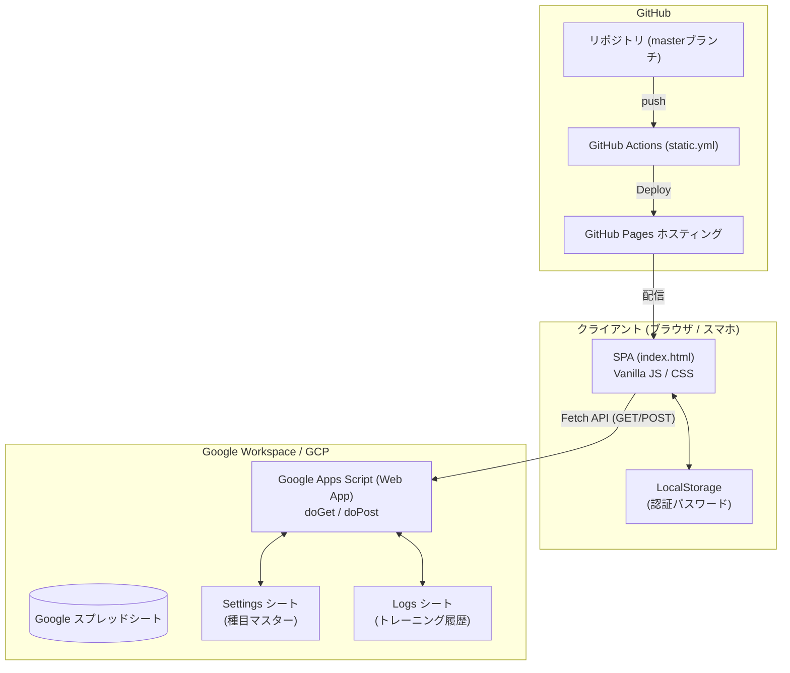

# 筋トレ記録アプリ 設計メモ (Architecture & Design Notes)

本書は、筋トレ記録アプリ（GitHub Pages + Google Apps Script + Googleスプレッドシート構成）のシステム設計、データ構造、API仕様、および運用方法をまとめた設計メモです。

---

## 1. プロジェクト概要

### 1.1 目的
スマートフォンからの日常的な筋トレ記録を素早く、ストレスなく行える軽量Webアプリケーション。

### 1.2 主な特徴
- **サーバーレス＆完全無料運用**: フロントエンドは GitHub Pages、バックエンドは Google Apps Script (GAS)、データベースは Google スプレッドシートを採用。
- **モバイルファースト / ダークテーマ**: スマホ片手でジムや自宅で記録しやすいUI設計。
- **SPA構成**: 外部ライブラリ非依存（Vanilla JS + CSS）の単一HTMLで高速表示。
- **分析・可視化機能**: 直近7日間の総負荷グラフおよび種目別の自己ベスト・成長ランキング表示。

---

## 2. システムアーキテクチャ

### 2.1 全体構成図


### 2.2 技術スタック
| レイヤー | 技術 / サービス | 説明 |
| :--- | :--- | :--- |
| **フロントエンド** | HTML5 / CSS3 / JavaScript (ES6+) | 依存関係なし（Vanilla JS）、HTML/CSS/JS 分離構成 |
| **ホスティング** | GitHub Pages | GitHub Actions 経由で静的配信 |
| **バックエンド** | Google Apps Script (GAS) | Web App として公開。RESTライクなエンドポイントを提供 |
| **データベース** | Google スプレッドシート | データの永続化ストア |

---

## 3. ディレクトリ構成

```
50_kintore/
├── .agents/
│   └── rules/
│       ├── git.md         # Git運用・コミットルール
│       └── project.md     # プロジェクト概要・開発方針
├── .github/
│   └── workflows/
│       └── static.yml     # GitHub Pages 自動デプロイ設定
├── css/
│   └── style.css          # アプリスタイル定義 (ダークテーマ・モバイル最適化)
├── docs/
│   └── design_memo.md     # 設計メモ（本書）
├── gas_side/
│   └── gas.js             # GAS 側バックエンドスクリプト（※.gitignore 対象）
├── js/
│   └── app.js             # フロントエンドロジック (Vanilla JS)
├── .gitignore             # 除外ファイル設定
├── index.html             # フロントエンドHTML (SPA構造)
└── memo.txt               # デプロイ済みGASのWeb App URL記録用（※.gitignore 対象）
```

> [!NOTE]
> `memo.txt` および `gas_side/` は、公開リポジトリへの認証情報やGASデプロイURL露出を防ぐため、`.gitignore` に指定されています。

---

## 4. データベース設計 (Google スプレッドシート)

スプレッドシートは2つのシートで構成されます。

### 4.1 `Settings` シート（種目マスター）
種目選択プルダウンの選択肢一覧を管理します。

| 行 / 列 | A列 (種目名) |
| :--- | :--- |
| 1行目 | ヘッダー (例: 種目名) |
| 2行目以降 | ベンチプレス, スクワット, デッドリフト, 懸垂, その他... |

- 1行目はヘッダー行として扱い、2行目以降の空文字を除外して取得します。

### 4.2 `Logs` シート（トレーニング実績ログ）
筋トレの各セット記録を蓄積します。

| 列 | カラム名 | 型 | 説明 | 例 |
| :---: | :--- | :--- | :--- | :--- |
| **A** | 日付 | Date / String | 実施日 (`yyyy-MM-dd`) | `2026-11-14` |
| **B** | 種目 | String | 種目名 | `ベンチプレス` |
| **C** | 重量 | Number | 負荷重量(kg)。自重の場合は `0` | `60` / `0` |
| **D** | 回数 | Number | レップ数 | `10` |

---

## 5. バックエンド / API 仕様 (GAS)

GAS Web App は `doGet(e)` および `doPost(e)` でリクエストを処理します。

### 5.1 共通認証仕様
- すべてのリクエストでパラメータまたはJSONボディに `pass`（SECRET_KEY: `kintore2026`）を含める必要があります。
- パスワード不一致時のレスポンス:
  ```json
  { "error": "auth_error", "message": "パスワードが違います" }
  ```

---

### 5.2 GET エンドポイント (`doGet`)

#### ① 日次記録取得モード (デフォルト)
指定日の合計負荷・当日の履歴および種目一覧を取得します。

- **URL パラメータ**:
  - `pass`: 認証キー (必須)
  - `date`: 日付文字列 (`YYYY-MM-DD` 形式)

- **レスポンス例**:
  ```json
  {
    "choices": ["ベンチプレス", "スクワット", "懸垂", "その他"],
    "totals": {
      "ベンチプレス": { "reps": 30, "volume": 1800 },
      "懸垂": { "reps": 20, "volume": 0 }
    },
    "history": [
      { "row": 15, "exercise": "ベンチプレス", "weight": 60, "reps": 10 },
      { "row": 14, "exercise": "ベンチプレス", "weight": 60, "reps": 10 }
    ]
  }
  ```
  ※ `history` は当日の新しい記録順（行番号降順）に返却されます。

#### ② 分析データ取得モード
直近7日間の総負荷グラフデータおよび種目ごとの全履歴を取得します。

- **URL パラメータ**:
  - `pass`: 認証キー (必須)
  - `mode`: `stats`

- **レスポンス例**:
  ```json
  {
    "choices": ["ベンチプレス", "スクワット", "懸垂"],
    "volumeByDate": {
      "2026-11-12": 3200,
      "2026-11-14": 1820
    },
    "historyByExercise": {
      "ベンチプレス": [
        { "date": "2026-11-14", "weight": 60, "reps": 10 },
        { "date": "2026-11-12", "weight": 65, "reps": 8 }
      ]
    }
  }
  ```

> [!NOTE]
> **負荷（Volume）の計算ルール**:
> - 重量 > 0 の場合: `重量 × 回数`
> - 自重（重量 == 0）の場合: `回数`

---

### 5.3 POST エンドポイント (`doPost`)

ブラウザのCORSプリフライト（OPTIONS）制限を回避するため、フロントエンドからは `Content-Type: text/plain;charset=utf-8` でJSON文字列を送信し、GAS側で `JSON.parse(e.postData.contents)` して受け取ります。

#### 共通リクエスト構造
```json
{
  "pass": "kintore2026",
  "action": "add" | "update" | "delete",
  "row": 12,
  "date": "2026-11-14",
  "exercise": "ベンチプレス",
  "weight": 60,
  "reps": 10
}
```

#### 各アクションの処理
1. **`add` (新規追加)**:
   - `Logs` シートの末尾に行を追加 (`appendRow([date, exercise, weight, reps])`)。
2. **`update` (更新)**:
   - 指定した行番号 `row`（2以上）のA〜D列を上書き更新。
3. **`delete` (削除)**:
   - 指定した行番号 `row`（2以上）の行自体を物理削除 (`deleteRow(row)`)。

- **成功時レスポンス**:
  ```json
  { "status": "success" }
  ```

---

## 6. フロントエンド機能設計 (`index.html`)

### 6.1 画面・ビュー構成
```
[ログイン画面] (初回またはログアウト時)
  └── パスワード入力 → LocalStorage 保存 ('kintore_pass')

[メイン画面]
  ├── ヘッダー (タイトル)
  ├── タブコンテンツ
  │     ├── 【入力タブ (📝)】
  │     │     ├── 日付ピッカー (過去日付の確認・入力可能)
  │     │     ├── この日の合計カード (種目ごとの総量・回数)
  │     │     ├── 入力/修正フォーム (種目、重量、回数)
  │     │     └── 当日の履歴カード (編集・削除ボタン付き)
  │     │
  │     └── 【分析タブ (📊)】
  │           ├── 直近7日間の総負荷棒グラフ
  │           └── 種目別の成長記録
  │                 ├── 種目選択プルダウン
  │                 ├── 絞り込みトグル (すべて / 自重のみ / 荷重あり)
  │                 ├── 順序切替トグル (1セット最高負荷 / 一日の総負荷)
  │                 └── トップ10ランキングリスト
  │
  └── ボトムナビゲーション (入力 / 分析 / ログアウト)
```

### 6.2 主要機能・ロジック仕様

#### 1. 状態管理 (State Management)
- `currentPass`: 現在の認証パスワード。
- `editingRow`: 編集中のスプレッドシート行番号。編集中はフォームが「記録を修正する」モード（アクセントカラー: `--edit`）に遷移。
- `cachedStatsHistory`: 分析タブで取得した種目別履歴のメモリキャッシュ。

#### 2. 入力フォームの柔軟性
- 種目で「その他」を選択した場合、テキスト入力フィールドが動的に表示され、スプレッドシートの選択肢にない新規種目をその場で入力可能。

#### 3. 分析タブの並び替え・フィルタ仕様
- **1セット最高負荷順 (`single`)**:
  - `(重量 > 0 ? 重量 × 回数 : 回数)` の降順でソート。同値時は重量優先、日付昇順。
  - 上位10件を表示。
- **一日の総負荷順 (`daily`)**:
  - 同一日・同一種目の負荷を合算し、総負荷の降順でソート。セット数も併記。

---

## 7. セキュリティと注意事項

1. **認証方式**:
   - 簡易秘密キー（`SECRET_KEY`）によるトークン認証を採用。
   - 個人利用・小規模利用を前提とした構成です。
2. **スプレッドシートの行番号（`row`）管理**:
   - 複数ユーザーによる同時追加・削除が発生すると行ズレのリスクがあります。
   - 個人利用を前提としているため、シンプルな行番号方式を採用しています。
3. **URL管理**:
   - GAS の Web App URL (`AKfycb...`) は公開リポジトリのコードに直書きされています。認証キーがあるため不正書き込みは防がれますが、より秘匿性を高める場合は環境変数の注入などの拡張が検討可能です。

---

## 8. デプロイおよび運用手順

### 8.1 GAS側の初回設定 / 更新手順
1. Google スプレッドシートを新規作成。
   - シート名を `Settings` と `Logs` に変更。
   - `Settings` のA列に初期種目を入力（例: 腕立て伏せ, 懸垂, スクワット, その他）。
2. メニュー「拡張機能」→「Apps Script」を開く。
3. `gas_side/gas.js` の内容をコードエディタに貼り付ける。
4. 「デプロイ」→「新しいデプロイ」:
   - 種類: **ウェブアプリ**
   - 次のユーザーとして実行: **自分**
   - アクセスできるユーザー: **全員** (Anyone)
5. 発行された「ウェブアプリ URL」をコピーし、`index.html` の `GAS_URL` 定数に設定。

### 8.2 フロントエンド (GitHub Pages) のデプロイ
1. `index.html` の変更を `master` ブランチへコミット＆プッシュ。
2. `.github/workflows/static.yml` の GitHub Actions が自動起動。
3. GitHub Pages 環境へデプロイ完了。
